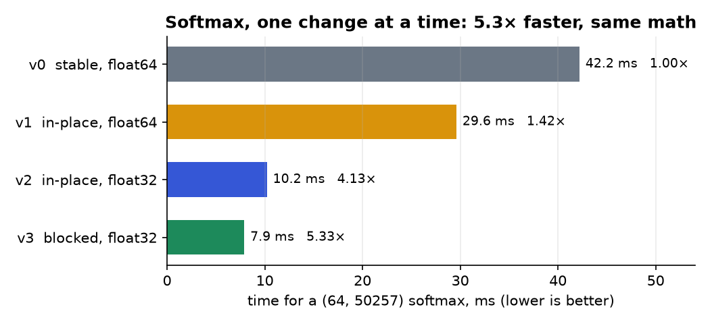
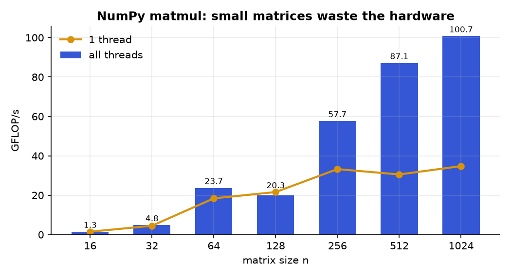
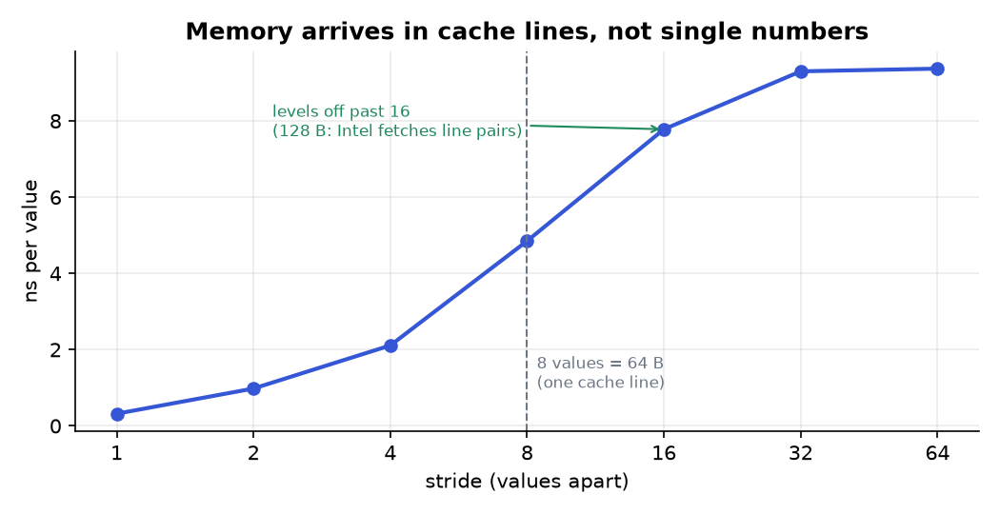
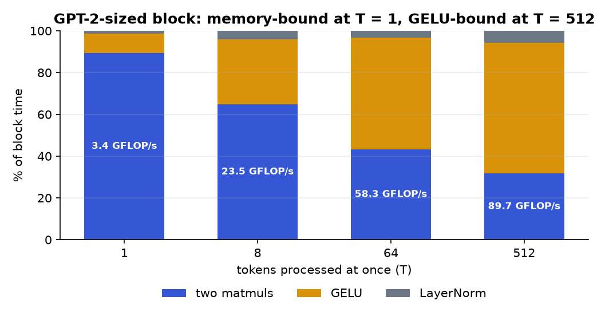

# numpy-inference-lab

[](https://github.com/spades02/numpy-inference-lab/actions/workflows/tests.yml)

Phase 1 of my path to AI inference engineering: the numerical building blocks
of neural networks, written by hand, tested, and benchmarked.

## Highlights

- **Softmax 5.3× faster without changing the math** (42.2 → 7.9 ms): no
  temporary arrays, float32, and cache-sized blocks. [Section 5](#5-making-softmax-faster)
- **A GPT-2-sized layer is memory-bound at 1 token and compute-bound at 512.**
  At T = 1 the matmuls read weights at 85% of memory bandwidth but reach only
  3.4 GFLOP/s; at T = 512 they reach 89.7 GFLOP/s. [Section 4](#4-transformer-block-feed-forward-half)
- **Reading the same bytes in a different order is 8.1× slower.** Memory
  arrives in cache lines, not single numbers. [Section 3](#3-memory-layout)
- **NumPy's float64 `exp`, not memory, is the softmax bottleneck on this CPU**,
  and float32 `exp` is 4.5× faster. [Section 2](#2-softmax)



## What's here

- `operations.py`: vector add, elementwise multiply, dot product, magnitude
- `matrix.py`: matrix multiplication in pure Python (with input validation) and NumPy
- `softmax.py`: naive and numerically stable softmax, batched over the last axis
- `layout.py`: byte offset of any element from an array's strides
- `block.py`: LayerNorm, GELU, feed-forward network, and a residual block
- `fused.py`: softmax with no temporary arrays, and a cache-blocked version
- `benchmarks/harness.py`: shared timer, 3 warm-up runs, then 20 timed runs
- `benchmarks/benchmark_matrix.py`: Python vs NumPy matmul, GFLOP/s
- `benchmarks/benchmark_softmax.py`: naive vs stable softmax at GPT-2 vocab size, GB/s
- `benchmarks/bandwidth_ceiling.py`: memory copy ceiling and exp throughput
- `benchmarks/benchmark_layout.py`: row vs column reads, and a stride sweep
- `benchmarks/benchmark_block.py`: time per stage of a GPT-2-sized block
- `benchmarks/benchmark_fused.py`: four softmax versions, one change at a time
- `benchmarks/make_charts.py`: draws the charts in `docs/charts/` from the results below
- `tests/`: correctness tests, including overflow, underflow, batches,
  rectangular shapes, empty input, incompatible dimensions, and memory
  offsets checked against real addresses, LayerNorm and GELU properties,
  and the residual connection

## Run it

```
uv sync
uv run python -m pytest -v
uv run python benchmarks/benchmark_matrix.py
uv run python benchmarks/benchmark_softmax.py
uv run python benchmarks/bandwidth_ceiling.py
uv run python benchmarks/benchmark_layout.py
uv run python benchmarks/benchmark_block.py
uv run python benchmarks/benchmark_fused.py
uv run python benchmarks/make_charts.py
```

## Environment

|        |                                                                                          |
| ------ | ---------------------------------------------------------------------------------------- |
| CPU    | Intel Core i5-10310U @ 1.70 GHz, 4 cores / 8 threads (laptop), 6 MB L3, AVX2, no AVX-512 |
| OS     | Windows                                                                                  |
| Python | 3.12                                                                                     |
| NumPy  | 2.5.4                                                                                    |
| BLAS   | scipy-openblas 0.3.34 (Haswell kernels)                                                  |
| Data   | float64 unless noted, random inputs, fixed seed                                          |

All timings are the minimum of 20 timed runs after 3 warm-up runs.

---

## 1. Matrix multiplication

Python is skipped above n = 128, where a single call would take seconds to minutes.

| n    | Python (ms) | NumPy (ms) | Speedup | NumPy GFLOP/s | NumPy, 1 thread (ms) |
| ---- | ----------- | ---------- | ------- | ------------- | -------------------- |
| 16   | 0.782       | 0.0061     | 128×    | 1.3           | 0.0056               |
| 32   | 2.830       | 0.0136     | 208×    | 4.8           | 0.0146               |
| 64   | 22.283      | 0.0221     | 1008×   | 23.7          | 0.0285               |
| 128  | 156.087     | 0.2068     | 755×    | 20.3          | 0.1942               |
| 256  | —           | 0.5818     | —       | 57.7          | 1.0096               |
| 512  | —           | 3.0819     | —       | 87.1          | 8.7927               |
| 1024 | —           | 21.3198    | —       | 100.7         | 61.7497              |

GFLOP/s = 2n³ floating-point operations ÷ time. The 1-thread column was
measured with `OPENBLAS_NUM_THREADS=1`.



**Findings**

1. **Python's cost per multiply-add settles at about 75–85 ns once n ≥ 32**,
   so its time grows with n³, as the triple loop predicts. At n = 16, fixed
   per-call overhead makes it look more expensive (~190 ns).
2. **NumPy's throughput rises about 75× with problem size**, from 1.3 GFLOP/s
   at n = 16 to 100.7 GFLOP/s at n = 1024. Small matrices can't keep the
   hardware busy: fixed call overhead dominates until there is enough work
   to amortize it.
3. **OpenBLAS multithreading starts paying off between n = 128 and n = 256.**
   At n = 1024, all threads are 2.9× faster than one thread on this 4-core
   CPU. At n ≤ 128 the two settings are within noise of each other.
4. **Throughput stalls between n = 64 and n = 128** (23.7 → 20.3 GFLOP/s),
   and it stalls with one thread too, so threading alone doesn't explain it.
   Not yet investigated.
5. **Laptop benchmarks are noisy.** Early runs with 5 repeats differed by up
   to 4× between identical runs. The minimum of 20 runs after warm-up made
   results reproducible enough to compare.

---

## 2. Softmax

Shape `(batch, 50257)`, the vocabulary size of GPT-2: one row of logits per
sequence being generated.

| Batch | Naive (ms) | Stable (ms) | Naive GB/s | Stable GB/s |
| ----- | ---------- | ----------- | ---------- | ----------- |
| 1     | 0.5170     | 0.6313      | 1.45       | 1.19        |
| 8     | 7.1037     | 9.3363      | 0.84       | 0.64        |
| 64    | 49.0254    | 58.3349     | 0.98       | 0.82        |

GB/s counts the minimum memory traffic: read the input once and write the
output once (2 × batch × 50,257 × 8 bytes).

**Hardware ceiling** (shape `(64, 50257)`, separate run):

| Operation                                             | GB/s | ns per number |
| ----------------------------------------------------- | ---- | ------------- |
| `np.copyto` (memory ceiling for one read + one write) | 16.1 | —             |
| `np.exp`, float64, one pass, no temporaries           | 2.6  | 6.10          |
| `np.exp`, float32, one pass, no temporaries           | ~5.8 | 1.37          |

**Findings**

1. **The naive version returns `nan` on large or very negative logits.**
   `exp` overflows to `inf` above x ≈ 709.78 (`inf / inf = nan`) and
   underflows to 0 for very negative inputs (`0 / 0 = nan`). Subtracting each
   row's max before `exp` fixes both without changing the result.
2. **Stability costs 20–30% more time.** Finding the max is an extra full pass
   over every row.
3. **Softmax should be memory-bound but isn't on this CPU.** At about 0.3
   operations per byte (vs ~85 for matmul at n = 1024) it should be limited by
   memory. Yet it reaches only 0.8–1.5 GB/s against a 16.1 GB/s ceiling.
4. **`exp` is the bottleneck.** A single pass of float64 `exp` reaches only
   2.6 GB/s (16% of the ceiling), about 6.1 ns per number on one core. It
   takes roughly half of softmax's time. The other half comes from the extra
   passes: the stable version does about 5 reads and 3 writes of the full array
   (plus 3 new temporary arrays) where the minimum is 1 read and 1 write.
5. **float32 `exp` is 4.5× faster per number than float64** (1.37 vs 6.10 ns).
   This is consistent with NumPy using a vectorized AVX2 path for float32 `exp`
   but needing AVX-512, which this CPU lacks, to vectorize float64 `exp`.
   The data type decides which code path runs.

**Next:** a fused version that makes fewer passes over memory, and float32
throughout.

---

## 3. Memory layout

NumPy stores a 2D array row by row (C order). Moving one step along an axis
skips a fixed number of bytes, called the stride. For an `(n, n)` float64
array the strides are `(n × 8, 8)`: n × 8 bytes to the next row, 8 bytes to
the next column. The byte offset of any element is

```
offset(i, j) = i × strides[0] + j × strides[1]
```

`tests/test_layout.py` checks this formula against the real memory addresses
NumPy reports, for both normal and transposed arrays.

### Same data, different reading order

`a.copy()` reads row by row. `a.T.copy()` reads down the columns of `a`. Both
read and write exactly the same bytes (2 × n² × 8).

| n    | copy (ms) | T.copy (ms) | copy GB/s | T.copy GB/s | T.copy slower by |
| ---- | --------- | ----------- | --------- | ----------- | ---------------- |
| 1024 | 2.502     | 10.86       | 6.71      | 1.55        | 4.3×             |
| 4096 | 38.31     | 311.0       | 7.01      | 0.86        | 8.1×             |

### Stride sweep

Sum the same number of values (2¹⁹) every time, spaced `stride` values apart.
Any difference in time comes only from where the values sit in memory.

| Stride       | 1    | 2    | 4    | 8    | 16   | 32   | 64   |
| ------------ | ---- | ---- | ---- | ---- | ---- | ---- | ---- |
| ms           | 0.17 | 0.51 | 1.11 | 2.54 | 4.08 | 4.88 | 4.91 |
| ns per value | 0.32 | 0.98 | 2.11 | 4.85 | 7.78 | 9.30 | 9.37 |



**Findings**

1. **Transposing is free; reading the transpose is not.** `a.T` copies no
   data. It shares memory with `a` and only swaps the strides to `(8, n × 8)`.
   The cost appears when the data is read in that order.
2. **Reading down columns is 4.3× slower at n = 1024 and 8.1× slower at
   n = 4096**, for exactly the same bytes. At n = 4096 the column read reaches
   only 0.86 GB/s. The gap grows with size, which is consistent with the
   cache: an 8 MB matrix is close to the 6 MB L3 cache, so some lines are
   still cached when the column walk returns for their neighbours. A 134 MB
   matrix is not, so almost every value costs a separate trip to RAM.
3. **Cost per value roughly doubles with each doubling of the stride up to
   16, then levels off** (9.30 ns at stride 32, 9.37 ns at stride 64). Memory
   is delivered in cache lines, not single numbers: once values are far enough
   apart that each one needs its own line, spreading them further costs
   nothing extra. The same shape appeared in three separate runs.
4. **The curve levels off at stride 16 (128 bytes), not 8 (64 bytes, one cache
   line).** This is consistent with Intel's prefetcher fetching cache lines in
   adjacent pairs, which makes the effective unit about 128 bytes on this CPU.
5. **The first step (stride 1 → 2) is 3.1×, more than the 2× the cache-line
   model predicts.** A contiguous array lets NumPy sum with SIMD instructions
   and a strided view does not, so this step mixes two effects.
6. **A normal `copy()` reaches about 7 GB/s, roughly half of the 16.1 GB/s
   `copyto` ceiling.** `copy()` allocates a new array on every call while
   `copyto` writes into an existing one, which likely accounts for the
   difference. Not yet measured separately.

---

## 4. Transformer block (feed-forward half)

The second half of one transformer layer, at GPT-2 small's sizes:

```
out = x + W2 · GELU(W1 · LayerNorm(x) + b1) + b2
       (T, 768) → (T, 3072) → (T, 768)
```

T is the number of tokens processed at once: 1 during text generation
(decode), hundreds while reading a prompt (prefill) or when many requests are
batched together. Weights use GPT-2's starting scale (normal, std 0.02).
Each stage is timed separately, with its input prepared outside the timer.

| Tokens (T) | LN (ms) | matmul 1 (ms) | GELU (ms) | matmul 2 (ms) | Total (ms) | Matmul share | Matmul GFLOP/s |
| ---------- | ------- | ------------- | --------- | ------------- | ---------- | ------------ | -------------- |
| 1          | 0.046   | 1.216         | 0.281     | 1.531         | 3.074      | 89%          | 3.4            |
| 8          | 0.197   | 1.660         | 1.542     | 1.557         | 4.955      | 65%          | 23.5           |
| 64         | 0.807   | 6.388         | 12.745    | 3.966         | 23.906     | 43%          | 58.3           |
| 512        | 9.640   | 34.054        | 106.480   | 19.827        | 170.001    | 32%          | 89.7           |

GFLOP/s = 2 × T × 768 × 3072 × 2 (two matmuls) ÷ time in the two matmuls.



**Findings**

1. **With one token, the matmuls are limited by memory.** The two weight
   matrices hold 37.7 MB (768 × 3072 × 8 bytes each). Every weight is loaded
   once and used once, so the 2.75 ms spent in the matmuls means weights arrive
   at 13.7 GB/s, 85% of the 16.1 GB/s copy ceiling, while compute reaches only
   3.4 GFLOP/s. This is the decode regime of LLM inference.
2. **With 512 tokens, the matmuls are limited by compute.** Each weight is
   reused for every token, and throughput reaches 89.7 GFLOP/s, close to the
   ~100 GFLOP/s peak measured in section 1. Processing many tokens or many
   requests together is what turns a memory-bound matmul into a compute-bound
   one. This is why LLM servers batch requests.
3. **GELU grows from 9% to 63% of the block's time** and takes longer than both
   matmuls combined at T = 512. It applies `tanh` to every one of T × 3072
   values, the same kind of expensive float64 math function as `exp` in
   section 2. Once the matmuls run efficiently, the elementwise step becomes
   the bottleneck.
4. **LayerNorm stays small** (2–6% of the time) because it works on T × 768
   values, a quarter of GELU's T × 3072.
5. **At T = 512, matmul 1 takes 1.7× longer than matmul 2** (34.1 vs 19.8 ms)
   for the same number of operations. Its output is 4× larger (T × 3072 vs
   T × 768), and adding the bias is a separate pass over that output. Not yet
   measured separately.

---

## 5. Making softmax faster

Starting from the stable softmax in section 2, change one thing at a time on a
`(64, 50257)` input and measure each step. Every version passes the same
correctness tests against the original (`rtol = 1e-5` for float32).

| Version | Change                                             | Bottleneck it attacks                  | ms    | GB/s | Speedup |
| ------- | -------------------------------------------------- | -------------------------------------- | ----- | ---- | ------- |
| v0      | stable softmax, float64 (section 2)                | —                                      | 42.21 | 1.22 | 1.00×   |
| v1      | write every step into one existing buffer (`out=`) | allocating 3 temporary 25 MB arrays    | 29.63 | 1.74 | 1.42×   |
| v2      | v1 in float32                                      | slow float64 `exp`, and half the bytes | 10.23 | 2.52 | 4.13×   |
| v3      | v2, 8 rows at a time (1.6 MB blocks)               | trips to RAM between the 5 passes      | 7.92  | 3.25 | 5.33×   |

GB/s counts the minimum traffic (one read and one write of the array) in each
version's own data type.

**Findings**

1. **The biggest win came from fixing the measured bottleneck.** Section 2
   showed `exp` was the bottleneck and float32 `exp` is 4.5× faster on this
   CPU. Switching to float32 gave 2.9× on top of v1, more than any other change.
2. **Removing temporary arrays gave 1.42×.** It couldn't reach 2×, because the
   `exp` work itself didn't change.
3. **Working in cache-sized blocks gave another 1.29×.** Each 8-row block
   (1.6 MB) fits in the 6 MB L3 cache, so passes 2–5 read from cache instead of
   RAM. This is the idea behind a fused GPU kernel: load data into fast memory
   once, do every step there, and write the result once. NumPy can't fuse
   operations, but blocking gets part of the benefit.
4. **The fastest version still uses only 20% of memory bandwidth** (3.25 of
   16.1 GB/s). At roughly 1.4 ns per value, float32 `exp` alone accounts for
   about half of v3's time. The remaining limit is computation on a single
   core, not memory.
5. **The same code gives different results on different hardware.** On a Linux
   test machine with AVX-512, float32 gave only 1.9× and blocking gave nothing.
   An optimization has to be measured on the hardware it is meant for.
6. **Tests prove correctness; benchmarks prove efficiency.** A first version of
   v3 ran the whole softmax once per block. It produced correct output and
   passed every test, but was 8× slower. Only the benchmark caught it.
